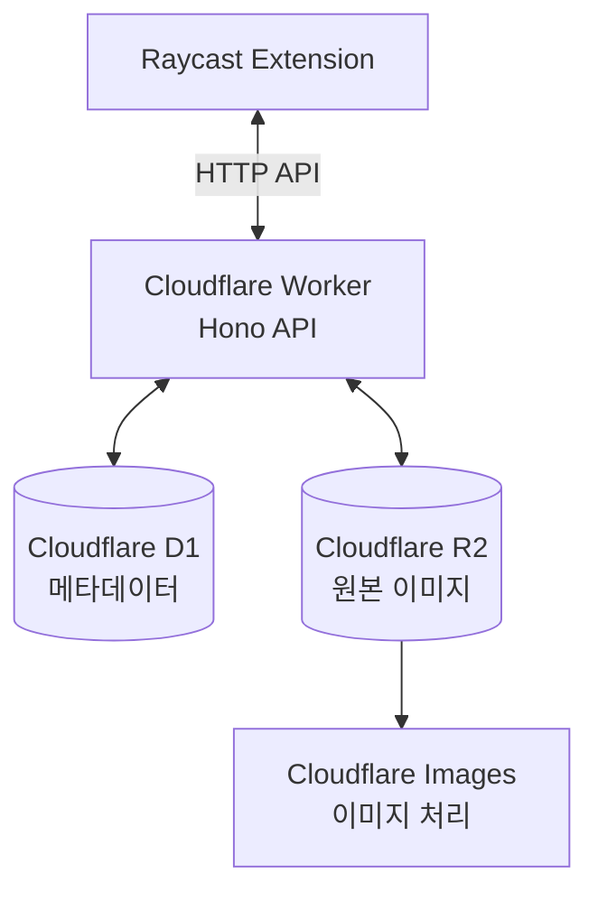

# 짤방 (Zzal)

**자주 사용하는 짤방을 Raycast에서 검색하고, 바로 붙여넣으세요.**

짤방을 로컬 폴더에 모아두고 매번 찾아다니는 대신, 키워드만 입력하면 필요한 이미지를 바로 검색하고 사용할 수 있는 개인용 짤방 관리 도구입니다.

Raycast에서 짤방을 검색하고 클립보드에 복사하거나 붙여넣을 수 있으며, 새로운 이미지를 등록하고 기존 이미지를 수정하거나 삭제할 수도 있습니다.

이미지 저장과 관리는 Cloudflare 기반의 서버리스 환경에서 처리합니다.

## 주요 기능

- **키워드 검색**: 저장된 짤방을 키워드로 빠르게 검색
- **이미지 미리보기**: 검색 결과에서 이미지 확인
- **빠른 사용**: 이미지를 클립보드에 복사하거나 바로 붙여넣기
- **이미지 등록**: 새로운 짤방을 업로드하고 관리
- **이미지 수정**: 등록된 짤방의 정보 수정
- **이미지 삭제**: 더 이상 필요하지 않은 짤방 삭제
- **자동 정리**: 삭제 후 30일이 지난 데이터 자동 영구 삭제

## 동작 방식

Raycast를 인터페이스로 사용하고, Cloudflare Worker를 통해 이미지와 메타데이터를 관리합니다.



| 구성 요소 | 역할 |
| --- | --- |
| Raycast | 검색 및 이미지 관리 인터페이스 |
| Cloudflare Workers | API 및 비즈니스 로직 |
| Hono | Worker API 라우팅 |
| Cloudflare D1 | 이미지 메타데이터 저장 |
| Cloudflare R2 | 이미지 원본 파일 저장 |
| Cloudflare Images | 이미지 처리 및 변환 |

## 시작하기

이미 배포된 Worker를 사용하거나, 자신의 Cloudflare 계정에 직접 배포하여 사용할 수 있습니다.

### Raycast 확장 설치

1. [Releases](https://github.com/4anghyeon/raycast-zzal-search/releases) 페이지에 접속합니다.
2. 최신 릴리스에서 `zzal-search.zip`을 다운로드합니다.
3. 압축을 해제합니다.
4. Raycast를 실행하고 `Import Extension`을 검색합니다.
5. 압축 해제한 폴더를 선택해 확장을 등록합니다.

### API 연결 설정

Raycast에서 `짤방 검색` 커맨드의 설정을 엽니다.

다음 두 가지 값을 입력합니다.

| 설정 | 설명 |
| --- | --- |
| `apiUrl` | 배포된 Cloudflare Worker 주소 |
| `apiToken` | Worker에 설정된 인증 토큰 |

예시:

```text
apiUrl   = https://zzal-worker.example.workers.dev
apiToken = YOUR_AUTH_TOKEN
```

`apiToken`에는 Worker의 `AUTH_TOKEN`과 동일한 값을 입력해야 합니다.

설정이 완료되면 `짤방 검색` 커맨드를 실행해 사용할 수 있습니다.

## 사용 방법

### 짤방 검색

1. Raycast에서 `짤방 검색`을 실행합니다.
2. 찾고 싶은 짤방의 키워드를 입력합니다.
3. 검색 결과에서 원하는 이미지를 선택합니다.
4. 제공되는 액션을 통해 이미지를 복사하거나 붙여넣습니다.

### 짤방 관리

검색 화면에서 제공되는 액션을 통해 이미지를 관리할 수 있습니다.

- 등록: 새로운 이미지를 업로드합니다.
- 수정: 기존 짤방의 정보를 변경합니다.
- 삭제: 더 이상 사용하지 않는 짤방을 삭제합니다.

## 직접 배포하기

자신의 Cloudflare 계정에 서비스를 배포하고 싶다면 아래 과정을 진행합니다.

### 사전 준비

- Node.js 및 npm
- Cloudflare 계정
- Cloudflare Workers, D1, R2 및 Images 사용 환경
- Raycast

### 1. 저장소 복제 및 의존성 설치

```bash
git clone https://github.com/4anghyeon/raycast-zzal-search.git

cd raycast-zzal-search

npm install
```

### 2. Cloudflare 인증

```bash
cd worker

npx wrangler login
```

브라우저에서 Cloudflare 계정 인증을 완료합니다.

### 3. D1 데이터베이스 생성

```bash
npx wrangler d1 create zzal-db
```

명령 실행 후 출력되는 `database_id`를 복사합니다.

`worker/wrangler.jsonc`의 `d1_databases` 항목에서 `database_id`를 자신의 데이터베이스 ID로 변경합니다.

### 4. R2 버킷 생성

```bash
npx wrangler r2 bucket create zzal-files
```

### 5. 데이터베이스 마이그레이션

```bash
npm run db:migrate:remote
```

원격 D1 데이터베이스에 필요한 스키마를 적용합니다.

### 6. API 인증 토큰 설정

충분히 안전하고 예측하기 어려운 토큰을 생성한 다음 Cloudflare Worker에 등록합니다.

```bash
npx wrangler secret put AUTH_TOKEN
```

명령 실행 후 생성한 토큰을 입력합니다.

Raycast 확장 설정에서도 동일한 토큰을 사용해야 합니다.

로컬 개발 환경에서는 `worker/.dev.vars.example`을 복사해 `worker/.dev.vars`를 만들고 `AUTH_TOKEN`을 설정합니다.

### 7. Worker 배포

```bash
npm run deploy
```

배포가 완료되면 출력되는 Worker URL을 Raycast의 `apiUrl`에 입력합니다.

## 로컬 개발

로컬에서 Worker와 Raycast 확장을 각각 실행할 수 있습니다.

프로젝트 루트에서 의존성을 설치한 후 두 개의 터미널을 사용합니다.

**Terminal 1: Worker**

```bash
cd worker

npm run dev
```

기본적으로 `http://localhost:8787`에서 실행됩니다.

**Terminal 2: Raycast**

```bash
cd raycast

npm run dev
```

Raycast 확장 설정에서 `apiUrl`을 로컬 Worker 주소로 변경하면 로컬 환경에 연결할 수 있습니다.

> 참고: Cloudflare Images는 로컬에서 완전히 에뮬레이션되지 않습니다. 현재 설정에서는 `remote: true`를 사용하므로 로컬 개발 중에도 실제 Cloudflare Images 서비스를 호출합니다.

## 프로젝트 구조

모노레포와 npm Workspaces를 사용합니다.

```text
raycast-zzal-search/
├── packages/
│   └── shared/          # 공통 타입 및 유틸리티
│
├── raycast/             # Raycast 확장
│   ├── src/
│   └── package.json
│
├── worker/              # Cloudflare Worker (Hono)
│   ├── src/
│   ├── migrations/
│   ├── wrangler.jsonc
│   └── package.json
│
├── package.json
└── package-lock.json
```

| 패키지 | 담당 역할 |
| --- | --- |
| `packages/shared` | 공통 타입 및 유틸리티 |
| `worker` | 짤방 등록, 조회, 수정, 삭제 API 및 자동 정리 작업 |
| `raycast` | 짤방 검색 및 관리 인터페이스 |

## 지원 형식 및 제한 사항

| 항목 | 내용 |
| --- | --- |
| PNG | 지원 |
| JPG / JPEG | 지원 |
| GIF | 지원 |
| WebP | 지원 |
| AVIF | 지원 |
| HEIC | 미지원 |
| 최대 파일 크기 | 20MB |

파일 형식은 확장자가 아닌 매직 바이트를 기준으로 판별하며, 최종 유효성 검사는 서버에서 수행합니다.

### 이미지 삭제 및 보관 정책

이미지를 삭제하면 즉시 영구 삭제하지 않고 Soft Delete 처리합니다.

삭제된 데이터는 30일 동안 보관되며, 이후 매일 실행되는 Cron 작업을 통해 원본 이미지, 썸네일 및 메타데이터를 영구 삭제합니다.

## 라이선스

Raycast 확장의 라이선스는 MIT입니다.
